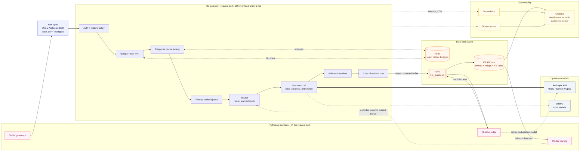
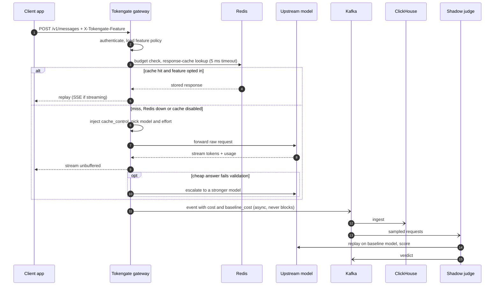

# Tokengate

An LLM gateway that sits in front of every model call, measures what each feature costs, and cuts the bill without lowering answer quality.

> Status: design phase. See [docs/PLAN.md](docs/PLAN.md) and [docs/PROGRESS.md](docs/PROGRESS.md).

## What it does

- **Meters every call:** tokens, cost, latency and cache usage per feature, tenant and model.
- **Caches:** provider prompt caching injected automatically, plus an exact response cache for features that opt in.
- **Routes:** sends easy requests to a smaller model, a lower effort level, or a free local model (Ollama); escalates when the cheap answer fails validation.
- **Proves the savings:** every request records what it *would* have cost on the original model with no caching, and a shadow evaluator checks that routed answers are as good as the originals.
- **Speaks your currency:** costs are stored in USD (what the provider bills) and shown in USD, INR, EUR or any configured currency.

Apps change only their base URL and add an `X-Tokengate-Feature` header.

## Architecture

Solid arrows are the data path, dotted arrows are optional or best-effort. Redis, Kafka and ClickHouse can all be down and requests still reach the provider.

### Life of a request

| Part | Tech |
|---|---|
| Gateway (request path) | Go |
| AI services (router training, shadow judge, traffic generator) | Python 3.14 + official `anthropic` SDK |
| Models | Anthropic API; Ollama for local, near-free tiers |
| Events | Kafka → ClickHouse |
| Cache, budgets, rate limits | Redis |
| Dashboards | Grafana, provisioned from this repo |
| Metrics and traces | Prometheus, OpenTelemetry |

## Repository layout

| Path | Contents |
|---|---|
| `gateway/` | Go gateway |
| `ai/` | Python services |
| `proto/` | gRPC contracts |
| `api/` | OpenAPI spec for the admin API |
| `deploy/` | Docker Compose, ClickHouse schema, Grafana dashboards, Prometheus rules, price and FX tables |
| `load/` | k6 load tests |
| `docs/` | Plan, progress, ADRs, runbook |

## Design decisions

See [docs/adr/](docs/adr/README.md).
